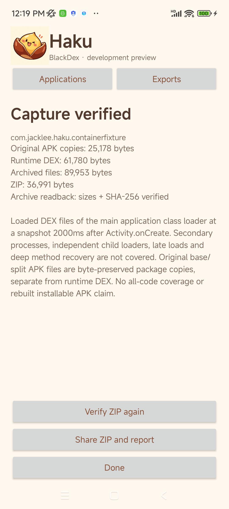

# Haku BlackDex container preview

Haku BlackDex provides an on-device Android capture and export workflow: choose an installed application, run its private container copy, inspect the result, then verify and share the export. Use applications you own or have permission to inspect.

The qualified preview route is **Android 13 / API 33 on ARM64**. The container capture code does not request root or use Xposed/LSPosed or Frida. This is a separate application from the earlier Haku LSPosed app; enabling an LSPosed module is not part of this workflow.

## Install the development variant

Download [Haku BlackDex64 Dev 0.2.0-dev.1](https://github.com/JackLee992/haku-blackdex/releases/download/v0.2.0-dev.1/haku-blackdex64-dev.apk) and check its [SHA256SUMS](https://github.com/JackLee992/haku-blackdex/releases/download/v0.2.0-dev.1/SHA256SUMS). The [release notes](https://github.com/JackLee992/haku-blackdex/releases/tag/v0.2.0-dev.1) include build receipts and validation scope.

| Item | Required identity for the qualified route |
| --- | --- |
| Launcher name | **Haku BlackDex64 Dev** |
| Application ID | `com.jacklee.haku.blackdex64` |
| Build variant | `BlackDex64Debug` |
| Development artifact filename | `haku-blackdex64-dev.apk` |
| Device | Android 13 / API 33, ARM64 |

If Android asks, permit the application you use to open the APK to install this development build. Keep the same development signing identity when updating an existing installation. A signing-conflict error requires a matching signed update or an uninstall/reinstall; export anything you need before uninstalling, because uninstalling removes Haku's private history.

The ARM32 variant has a different application ID, `com.jacklee.haku.blackdex32`, and is outside the current physical-device qualification. Other Android versions are outside this preview's supported capture route.

## Capture an application

1. Open **Haku BlackDex64 Dev**. Select **Applications** if necessary.
2. Enter an application name or package name in **Search applications**. The list includes installed applications; there is no package allowlist. Being listed does not establish that an application is compatible with the container.
3. Tap the application. Review its package name and original package size, then tap **Start capture**.
4. Haku copies the selected application's installed base APK and any split APKs into private staging storage. It checks complete writes and SHA-256 readback before starting the container. Copy progress shows exact completed and total bytes.
5. The container opens the application. Use its initial screen as needed while Haku observes the launch. The current capture takes a snapshot of standard DEX loaded in the main application's class loader approximately two seconds after its first Activity is created. Stage messages describe actual engine events; an indeterminate progress bar means the engine has not supplied a numeric total.
6. When the capture process ends, Haku verifies the runtime artifacts, builds the ZIP, and rereads its entries. The container process normally closes and reveals Haku. If necessary, return to Haku through Android's recent-apps view.
7. Read the result and its byte counts. Tap **Verify ZIP again** for an independent reread, then **Share ZIP and report** to open Android's share chooser. Tap **Done** to return to applications.

To stop a running attempt, return to Haku and tap **Cancel capture**. During APK preparation this stops the local copy before container launch. Once an engine session exists, cancellation targets that exact session and waits for its terminal report. If the session has already completed, its completed result wins. Cancellation is disabled once final export verification has begun.

## Read the result

| Result | Meaning |
| --- | --- |
| **Capture verified** | The session's required launch evidence and runtime artifacts passed engine checks; original package copies and ZIP readback also passed. The scope remains the coverage stated in the report. |
| **Partial export** | Some reported runtime DEX was copied and checked, but the complete capture/export requirements were not met. Read the error and coverage before using the files. |
| **Capture failed** | The requested capture/export did not meet its requirements. An unchanged APK copy by itself does not make a runtime capture successful. A diagnostic report may still be available. |
| **Capture cancelled** | This attempt was cancelled. Its receipt records `cancelled: true` and a failed status; any retained diagnostic files remain available through history. |

Sizes are shown as exact byte counts. For example, a 23,836-byte DEX is meaningful even though a whole-MiB display could round it to zero. **Original APK copies**, **Runtime DEX**, **Archived files**, and **ZIP** are different totals: archived files also include reports, and ZIP compression changes the final archive size.

Each capture has a separate session directory and export receipt. Files from a previous run do not count as success for a new attempt. A timeout produces a failed result rather than treating an existing directory as proof of capture.

## Understand the exported files

A successful export supplies two files to the share chooser:

```text
export.zip
report.json
```

The ZIP layout is:

```text
export.zip
├── original/
│   ├── base.apk
│   └── <original split APK basename>.apk   # only when the installed app has splits
├── runtime/
│   └── <SHA-256>.dex                      # one entry per captured DEX
├── capture-report.json
└── package-copy-report.json
```

Split APK basenames are preserved and checked for collisions. Actual entry names, counts, sizes and hashes are recorded in `report.json`; use that inventory rather than assuming a fixed number of DEX or split files. A failed or partial export may contain fewer files or only a diagnostic report.

| File or receipt origin | Contents |
| --- | --- |
| `original/…` · `package_copy` | Byte-preserved copies of the installed base/split APKs, including their existing package contents and signatures. They are not runtime DEX captures. |
| `runtime/…` · `runtime_dex` | Standard DEX bytes captured from the running container and checked against the engine's artifact hashes and lengths. The content hash supplies the filename. |
| `capture-report.json` · `engine_report` | Session identity, Android/ABI details, launch evidence, Activity/service records, runtime artifact inventory, validation information, errors and capture coverage. |
| `package-copy-report.json` · `package_report` | Selected package/version metadata, original base/split roles, original basenames, copy lengths and hashes. |
| External `report.json` | Export receipt with separate package/runtime byte totals, origin labels, copies of the two reports, and the published ZIP's size, SHA-256 and complete entry inventory. |

Keep `report.json` alongside `export.zip`. **Verify ZIP again** checks the saved ZIP's length and SHA-256, then rereads every entry and compares its length and hash with the receipt. Verification also runs before sharing an existing ZIP.

The export preserves original APK bytes and exports runtime DEX separately. It does not replace the APK's DEX, rebuild or sign a package, or establish that a modified APK would install or run.

## History and sharing

Select **Exports** to see local results, newest first. Tap a row to reopen its result, verify its ZIP again, or share it. Failed and cancelled attempts with published receipts also appear here.

Haku stores captures and exports in its private application storage. It does not require broad read/write storage access or an “all files” grant for this route. Sharing grants the chosen receiver read-only content access to the selected `export.zip` and `report.json`. It does not expose the application data directory. Choose a compatible receiver in Android's share chooser to save or send the files.

Clearing Haku's application data or uninstalling it removes this local history. Export the files you need first.



## Qualification and limits

The current physical-device acceptance used an owned fixture on a Redmi device running Android 13 / API 33 with an ARM64 host. The application was selected and captured through the actual GUI. Independent verification accepted:

- The exact original base APK: **25,178 bytes**.
- Three original-byte target runtime DEX files totaling **61,780 bytes**, including the fixture's packaged `classes.dex` and two distinct **23,836-byte** payloads that were decoded, executed, registered in the main application loader and deleted from their source files before capture.
- A ZIP with matching entry inventory, CRC, lengths and SHA-256 hashes, plus Android SDK DEX-parser acceptance. Its exact size and digest are in the [validation summary](validation/android13-arm64-20261023.json).
- Application launch, two Activities with navigation/result delivery, and a started Service in a separate worker process.

Haku’s own injected support archives are excluded by exact source path. The lab phone was rooted; authorized Shell root was used for test installation and collection, while capture ran in the ordinary app process. An unrooted stock device was not separately qualified. These counts describe that acceptance fixture and build, not expected output sizes for other applications. The worker Service result establishes the tested service lifecycle; it does not establish capture of worker-only DEX.

The runtime capture scope remains the standard DEX loaded in the main application's class loader at its capture snapshot. Independent child loaders, code loaded later, all secondary-process code, every method, bound/foreground/restarted service behavior, and arbitrary application compatibility are not guaranteed. Read each session's `coverage` and `serviceScope` fields for the exact boundary.

The experimental API 33 `LoadMethod` hook remains **off by default** and is not required for the qualified container path. Deep `ArtMethod` recovery is unsupported on Android 13+. This guide does not ask you to enable either feature.

## When a run does not complete

| Symptom | Action |
| --- | --- |
| Android version warning | Use an Android 13 / API 33 ARM64 device for this qualified preview. |
| Private storage or quota error | Free device storage and retry. The preview limits uncompressed export content to 2 GiB and reserves space for staged copies, the ZIP and verification. The displayed error gives the applicable byte requirement. |
| Original APK copy changed or failed readback | Allow an application update to finish, then retry. A failed or incomplete copy is not promoted to a verified original package. |
| Container install/launch, provider, Activity or Service failure | Read the checkpoint/error in the result and report. Application compatibility may be incomplete even when another application succeeds. |
| No verified runtime DEX or a partial result | Inspect the runtime inventory and coverage. An original APK copy does not prove that runtime code was captured. |
| ZIP verification fails | Keep the diagnostic result and retry the capture. Sharing that ZIP is blocked when its verification fails. |
| No compatible share application | Install or select a receiver that accepts ZIP/JSON files. The local result remains in **Exports**. |

For a reproducible issue, retain the matching `report.json`, the APK/build receipt for the Haku host, and a description of the selected application's launch steps. Share application artifacts only where you are authorized to do so.

Developers building the host from source can use [HOST_BUILD.md](HOST_BUILD.md).
